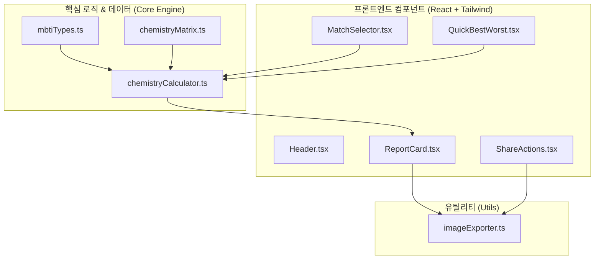

# MBTI 궁합 웹 애플리케이션 구현 계획서 (Implementation Plan)

> **For agentic workers:** REQUIRED SUB-SKILL: Use superpowers:subagent-driven-development to implement this plan task-by-task. Steps use checkbox (`- [ ]`) syntax for tracking.

**Goal:** 두 사람의 MBTI와 관계 유형(연인 vs 친구)을 선택하여 궁합 점수, 환상의 시너지, 갈등 주의점, 맞춤 소통 팁을 확인하고 SNS 카드 이미지 및 URL로 공유할 수 있는 React + Vite 웹 애플리케이션 구축.

**Architecture:** 100% 클라이언트 사이드 싱글 페이지 애플리케이션(SPA). 16x16 정적 매트릭스 및 관계 분석 계산 엔진을 분리하여 TDD로 검증하고, Tailwind CSS 기반의 반응형 카드 뷰와 `html-to-image` 기반 캡처 엔진을 연동한다.

**Architecture Diagram:**

**Tech Stack:** React 18, TypeScript, Vite, Tailwind CSS, Lucide React, html-to-image, Vitest, @testing-library/react

**Spec:** [2026-10-14-mbti-chemistry-design.md](file:///c:/Users/bbakj/Downloads/mbti/docs/superpowers/specs/2026-10-14-mbti-chemistry-design.md)

## Global Constraints
- Node.js 환경에서 구동 가능한 표준 Vite + React + TypeScript 템플릿 준수
- 외부 백엔드 API 호출 없이 클라이언트 측에서 모든 연산 및 이미지 생성이 즉시 완료되어야 함
- 16x16 = 256개 모든 MBTI 조합에 대해 데이터 누락 없이 점수 및 분석 결과를 반환해야 함
- 모바일 뷰포트(최소 360px) 및 데스크톱 환경 모두에서 깨짐 없는 반응형 레이아웃 유지

---

### Task 1: 프로젝트 환경 설정 및 베이스라인 구축 (Scaffolding)

**Files:**
- Create: `package.json`
- Create: `vite.config.ts`
- Create: `tsconfig.json`
- Create: `tsconfig.node.json`
- Create: `tailwind.config.js`
- Create: `postcss.config.js`
- Create: `index.html`
- Create: `src/index.css`
- Create: `src/main.tsx`

**Interfaces:**
- Produces: React + Vite + Tailwind + Vitest 실행 및 테스트 환경

- [ ] **Step 1: package.json 생성 및 종속성 정의**
  - react, react-dom, lucide-react, html-to-image
  - devDependencies: vite, typescript, tailwindcss, autoprefixer, postcss, vitest, @types/react, @types/react-dom

- [ ] **Step 2: Vite, TypeScript, Tailwind 설정 파일 작성**
  - `vite.config.ts` (vitest config 포함)
  - `tsconfig.json`, `tailwind.config.js`, `postcss.config.js`, `index.html`, `src/index.css`

- [ ] **Step 3: 의존성 패키지 설치 (`npm install`) 및 빌드 테스트**
  - 실행: `npm install`
  - 실행: `npx vitest --version`

- [ ] **Step 4: Commit**
  - `git add .`
  - `git commit -m "chore: scaffold react vite tailwind project structure"`

---

### Task 2: MBTI 데이터 정의 및 궁합 계산 엔진 구현 (TDD)

**Files:**
- Create: `src/data/mbtiTypes.ts`
- Create: `src/data/chemistryMatrix.ts`
- Create: `src/utils/chemistryCalculator.ts`
- Test: `tests/chemistryCalculator.test.ts`

**Interfaces:**
- Produces:
  - `MBTI_TYPES: Record<MBTICode, MBTITypeInfo>`
  - `calculateChemistry(m1: MBTICode, m2: MBTICode, mode: 'love' | 'friend'): ChemistryResult`
  - `getBestAndWorstMatches(mbti: MBTICode): { best: MatchRankItem[]; worst: MatchRankItem[] }`

- [ ] **Step 1: 실패하는 단위 테스트 작성 (`tests/chemistryCalculator.test.ts`)**
  - 16x16 모든 조합(256개)에 대해 0~100 사이의 점수 반환 검증
  - 대칭성 검증 (A x B 점수 == B x A 점수)
  - 연인/친구 모드에 따른 조언 텍스트 반환 검증
  - 동일 MBTI(INFP x INFP) 특별 처리 검증
  - 최고/최악 궁합 랭킹 추출 함수 검증

- [ ] **Step 2: 테스트 실행하여 실패 확인**
  - 실행: `npx vitest run tests/chemistryCalculator.test.ts`
  - 예상: FAIL (함수 및 모듈 미존재)

- [ ] **Step 3: MBTI 타입 메타데이터 및 16x16 케미 매트릭스 구현**
  - `src/data/mbtiTypes.ts` (16개 성향 이름, 키워드, 배지 색상)
  - `src/data/chemistryMatrix.ts` (16x16 궁합 점수표, 시너지, 주의점, 조언)

- [ ] **Step 4: 계산 엔진 구현 (`src/utils/chemistryCalculator.ts`)**
  - `calculateChemistry` 및 `getBestAndWorstMatches` 함수 구현

- [ ] **Step 5: 테스트 실행하여 통과 확인**
  - 실행: `npx vitest run tests/chemistryCalculator.test.ts`
  - 예상: PASS

- [ ] **Step 6: Commit**
  - `git add src/data src/utils tests`
  - `git commit -m "feat: implement MBTI chemistry data matrix and calculation engine with unit tests"`

---

### Task 3: 선택기 및 인터랙션 컴포넌트 개발

**Files:**
- Create: `src/components/Header.tsx`
- Create: `src/components/MatchSelector.tsx`
- Create: `src/components/QuickBestWorst.tsx`

**Interfaces:**
- Consumes: `MBTI_TYPES`, `getBestAndWorstMatches`
- Produces:
  - `Header`: 상단 로고 및 브랜딩 컴포넌트
  - `MatchSelector`: 모드(love/friend), 나의 MBTI, 상대방 MBTI, 이름 입력 폼 및 분석 제출 이벤트
  - `QuickBestWorst`: 선택된 MBTI 기준 환상의 짝꿍 TOP 3 및 주의할 궁합 TOP 3 퀵 프리뷰 모달/패널

- [ ] **Step 1: Header 컴포넌트 구현**
  - 깔끔한 하트 & 케미 아이콘 및 헤드라인 배치

- [ ] **Step 2: MatchSelector 컴포넌트 구현**
  - 관계 모드 토글 (연인 모드 💖 vs 친구/동료 모드 🤝)
  - 16개 MBTI 그리드/태그 선택 인터페이스
  - 유효성 검사 (두 MBTI 모두 선택 시 분석 버튼 활성화)

- [ ] **Step 3: QuickBestWorst 컴포넌트 구현**
  - '내 MBTI의 최고/최악 궁합 엿보기' 버튼 클릭 시 팝업 카드 렌더링

- [ ] **Step 4: Commit**
  - `git add src/components`
  - `git commit -m "feat: add Header, MatchSelector, and QuickBestWorst components"`

---

### Task 4: 결과 리포트 카드 및 이미지 저장/공유 컴포넌트 개발

**Files:**
- Create: `src/components/ReportCard.tsx`
- Create: `src/components/ShareActions.tsx`
- Create: `src/components/Toast.tsx`
- Create: `src/utils/imageExporter.ts`

**Interfaces:**
- Consumes: `ChemistryResult`, `html-to-image`
- Produces:
  - `ReportCard`: 인스타 스토리 규격/카드 뷰 형태의 결과 시각화 컴포넌트
  - `imageExporter.downloadElementAsImage`: DOM 요소를 고화질 PNG 이미지로 변환 및 다운로드
  - `ShareActions`: 이미지 저장 버튼, 결과 URL 클립보드 복사 버튼, 다시하기 버튼
  - `Toast`: 링크 복사 성공 알림 피드백 토스트

- [ ] **Step 1: imageExporter 유틸리티 구현**
  - `html-to-image`의 `toPng`를 호출하여 캔버스 다운로드 처리 및 모바일 롱프레스 대비 예외 처리

- [ ] **Step 2: ReportCard 컴포넌트 구현**
  - 점수 게이지 및 5단계 등급 뱃지
  - 시너지(잘 맞는 점), 갈등 포인트(주의할 점), 특급 처방 솔루션 섹션 구성
  - 캡처 대상 ref 바인딩 지원

- [ ] **Step 3: ShareActions 및 Toast 컴포넌트 구현**
  - 이미지 다운로드 로딩 상태 처리, 클립보드 복사 및 토스트 피드백 표시

- [ ] **Step 4: Commit**
  - `git add src/components/ReportCard.tsx src/components/ShareActions.tsx src/components/Toast.tsx src/utils/imageExporter.ts`
  - `git commit -m "feat: add ReportCard visualization and image export share components"`

---

### Task 5: 전체 통합, URL 파라미터 연동 및 최종 검증

**Files:**
- Modify: `src/App.tsx`
- Modify: `src/main.tsx`

**Interfaces:**
- Consumes: `MatchSelector`, `ReportCard`, `ShareActions`, `Toast`, `chemistryCalculator`
- Produces: 완성된 웹 애플리케이션 진입점 및 딥링크(`?m1=...&m2=...&mode=...`) 지원

- [ ] **Step 1: App.tsx 상태 관리 및 화면 전환 통합**
  - URL 파라미터(`m1`, `m2`, `mode`) 감지하여 링크 공유 접속 시 즉시 결과 화면 표시
  - '다시하기' 시 입력 화면으로 전환

- [ ] **Step 2: 반응형 모바일 UI 디테일 및 애니메이션 보정**
  - 부드러운 전환 효과, 모바일 화면 패딩 및 폰트 튜닝

- [ ] **Step 3: 전체 테스트 및 프로덕션 빌드 검증**
  - `npx vitest run` (모든 단위 테스트 통과 확인)
  - `npm run build` (TypeScript 타입 에러 없이 배포용 dist 빌드 성공 확인)

- [ ] **Step 4: Commit**
  - `git add src/App.tsx src/main.tsx`
  - `git commit -m "feat: integrate full application flow with URL deep linking and build verification"`
